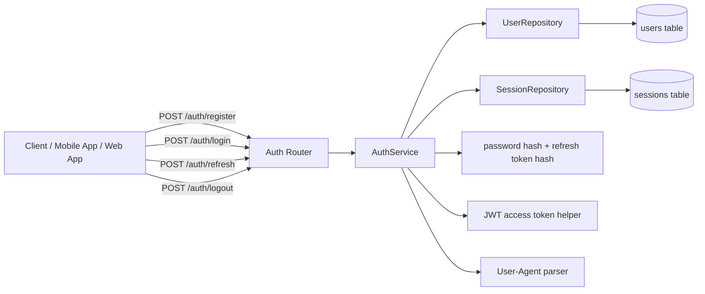
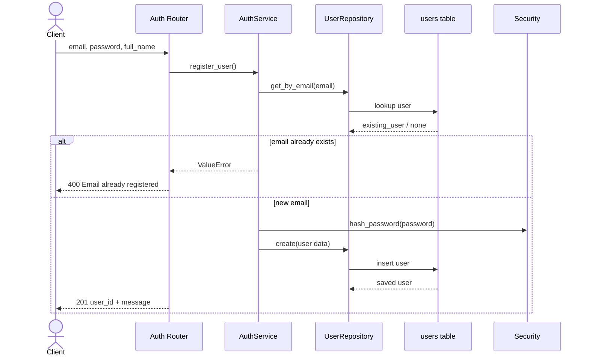
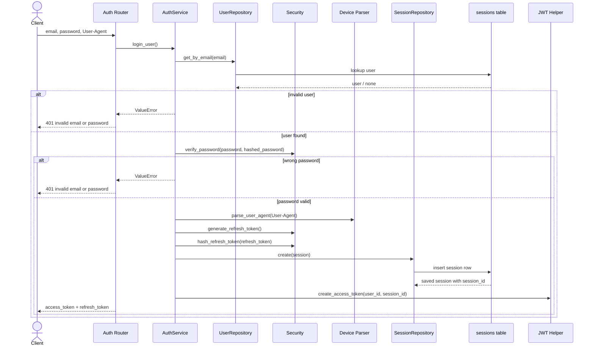
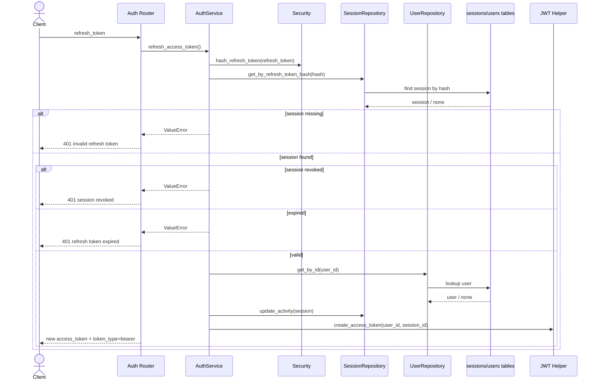
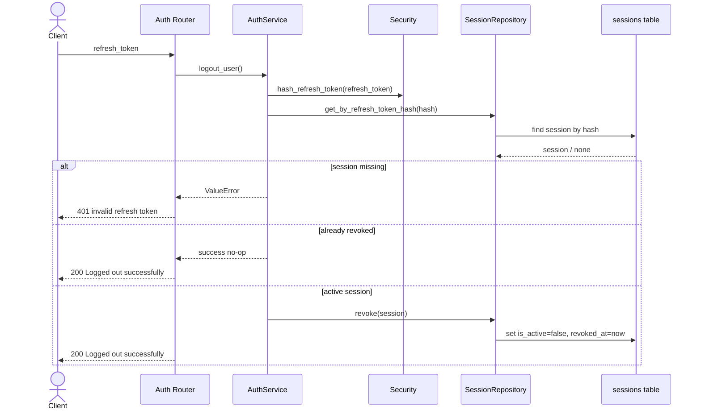
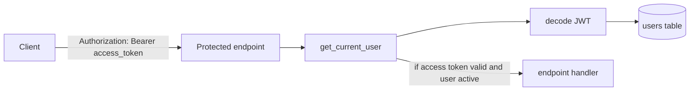
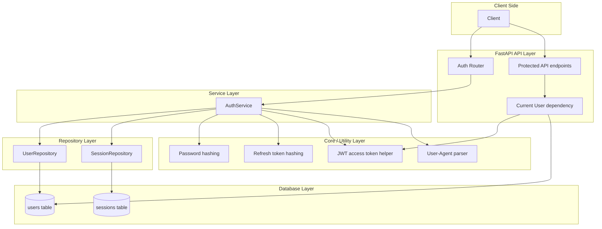
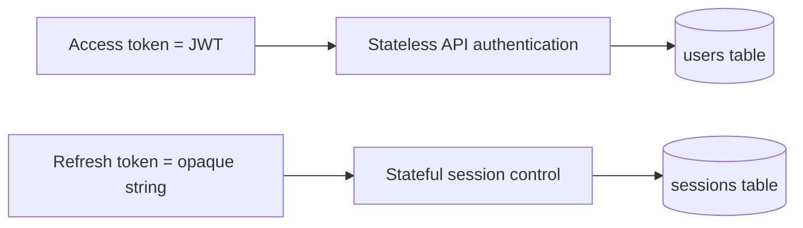

# Auth Architecture Diagrams

This file contains copy-pasteable Mermaid code for the authentication architecture described for the current backend.

## 1. High-level architecture

## 2. Register flow

## 3. Login flow

## 4. Refresh flow

## 5. Logout flow

## 6. Protected request flow

## 7. Box layout for Excalidraw

## 8. Quick summary of the real auth design

